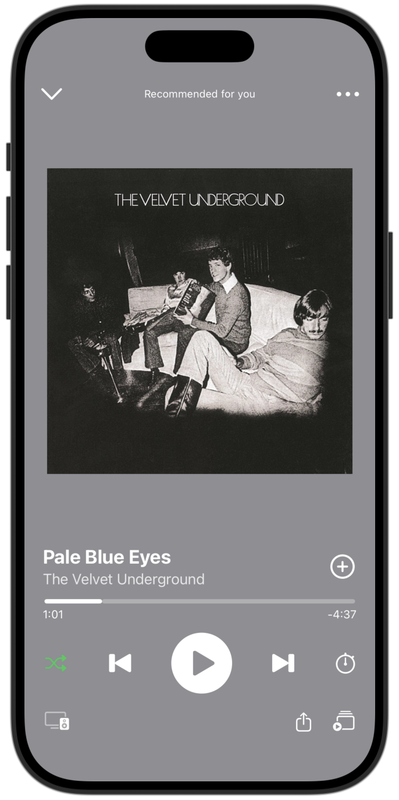

# Spotify UI Clone

A recreation of Spotify's **Now Playing screen** built with SwiftUI. This project focuses on replicating the layout and visual design of Spotify's music player interface using native iOS components.

## Features

- Recreated Spotify's Now Playing screen, including album artwork, song information, and playback controls.
- Built a responsive layout using SwiftUI components such as `VStack`, `HStack`, `ZStack`, and `Spacer`.
- Used **SF Symbols** for playback controls, shuffle, sharing, and other interface icons.
- Applied custom styling, spacing, and colors to closely match Spotify's design.

**Note:** This project is a static UI recreation. Playback controls are visual elements and do not provide functional music playback.

## Technologies Used

- **Language:** Swift
- **Framework:** SwiftUI
- **IDE:** Xcode
- **Platform:** iOS

## Screenshot

## What I Learned

- Building and organizing interfaces using SwiftUI's declarative syntax.
- Using stacks, spacers, and padding to create structured layouts.
- Customizing UI elements with SF Symbols, fonts, colors, and modifiers.
- Translating an existing app design into a native iOS interface.

## Disclaimer

This project was created for educational purposes and is not affiliated with or endorsed by Spotify.
